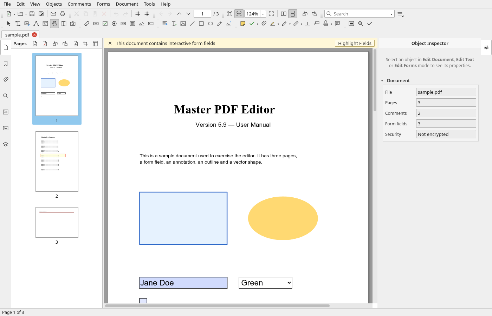

# Master PDF Editor (replica)

A from-scratch desktop re-implementation of the [Master PDF Editor](https://code-industry.net/masterpdfeditor/) workspace for **Windows 10+, macOS and Linux**. The same code runs on all three (Electron), so the interface is identical everywhere; it also runs in a browser with fewer features.



Rendering is done by **pdf.js**, writing by **pdf-lib**, and **MuPDF** (WASM) does what pdf-lib cannot: removing original page content, true redaction, decrypting and encrypting (RC4 40/128, AES-128, AES-256) and compacting with object streams. Digital signatures are real PKCS#7 signatures made with **node-forge**. There is no build step: plain ES modules.

This project is independent of Code Industry Ltd, the makers of Master PDF Editor; see `THIRD-PARTY-NOTICES.md`.

## Installation

### From a packaged folder (no Node.js needed)

Download or build the folder for your platform (see *Build packages* below), then:

| Platform | Steps |
|---|---|
| **Windows 10/11** | Copy `Master PDF Editor-win32-x64` anywhere (for example `C:\Program Files\Master PDF Editor`), then run `Master PDF Editor.exe`. SmartScreen warns on first launch because the build is unsigned: choose *More info → Run anyway*. For a Start-menu entry, right-click the exe → *Pin to Start*, or create a shortcut in `%APPDATA%\Microsoft\Windows\Start Menu\Programs`. |
| **macOS 12+** | Copy `Master PDF Editor.app` from `Master PDF Editor-darwin-arm64` (Apple silicon) or `-darwin-x64` (Intel) into `/Applications`. The first time, right-click the app → *Open* and confirm, because it is not notarised. If macOS says the app is damaged, run `xattr -dr com.apple.quarantine "/Applications/Master PDF Editor.app"` once. |
| **Linux** | Run `scripts/install-linux.sh` (or `npm run install:linux` from a checkout). It copies the build to `~/.local/opt/master-pdf-editor`, adds *Master PDF Editor* to your applications menu with the icon and PDF file association, and puts `master-pdf-editor` on your `PATH`. `scripts/uninstall-linux.sh` reverses it. |

Optional per-platform extras:

* **Scanning** uses SANE on Linux (`sudo apt install sane-utils`, already present on most desktops) and on macOS (`brew install sane-backends`); Windows uses the built-in Windows Image Acquisition service.
* **Email with attachment** uses `xdg-email` on Linux, Mail on macOS and Outlook on Windows; without those it opens your mail client with `mailto:` and shows the file to attach.

### From source

Requires Node.js 20 or later and npm.

```bash
git clone https://github.com/sweetld/master-pdf-editor.git
cd master-pdf-editor
npm install
npm run vendor      # copies pdf.js, pdf-lib and MuPDF into vendor/ (already committed; run after upgrading them)
npm start           # opens the desktop window
```

Other commands:

```bash
npm run dev         # desktop window with DevTools
npm run smoke       # headless self-test; prints a SMOKE-RESULT JSON line
npm run smoke:layout  # only the selection/re-layout checks; also writes /tmp/mpe-layout-*.png screenshots
npm run test:mcp    # end-to-end test of the MCP server (drives the app like an AI agent)
npm run docs:mcp    # regenerates docs/MCP_TOOLS.md from electron/mcp-tools.cjs
npm run web         # browser mode at http://127.0.0.1:8765/ (no scanner, no cryptographic signing)
npm run sample      # regenerates samples/sample.pdf
```

Pass a PDF path on the command line to open it (`npm start -- file.pdf`), or drag files onto the window.

### Build packages

```bash
npm run package           # dist/ for linux-x64, win32-x64, darwin-x64 and darwin-arm64
npm run package:linux     # or one platform: package:win, package:mac
```

Each `dist/…` folder is a complete runnable application built with @electron/packager (about 300 MB, mostly Electron). All platforms can be built from Linux; the Windows exe only receives its icon when Wine is installed on the build machine, and macOS code signing and notarisation need a Mac with an Apple Developer account (not done here).

## Features

| Menu | Items |
|---|---|
| File | New (Blank, From Files, From Scanner*), Open, Reload, Recent Files, Sessions, Save, Save As, Save Optimized As, Export (pages to PNG/JPEG/BMP/TIFF, Text, Excel, CSV, Word, extract all images, PDF/A), Email, Print, System Print, Properties (Description, Security, Fonts, Initial View, Advanced), Close, Exit |
| Edit | Undo/Redo (40 levels, incl. page operations), Cut/Copy/Paste, Paste at Copy Position, Paste to Multiple Pages, Delete, Delete across pages, Select All, z-order, Align Objects (6), Set Fit to Page |
| View | Go To (first/prev/next/last/page, previous/next view), Zoom, Fit Page, Fit Width, Facing, Continuous, cover page, Grid, Snap to Grid, Replace document colors, rotate view, Find/Next/Previous, Compare, Navigation Panels, Object Inspector, Menu (F12), Full Screen (F11), Toolbars (show/hide each, settings, reset), Status Bar |
| Objects | Formatted Text, Text, Image, Line, Rectangle, Ellipse, Pencil, Place Initials — select, move, resize (handles, Shift keeps aspect), rotate (handle, Shift snaps 45°), nudge with arrows (Ctrl = 1 pt), inline text editing by double-click, edit/move/delete of the document's **existing** text, images and vector objects |
| Comments | Sticky Note (15 icons), Typewriter, Callout, Label (6 markers), Comment View (show/hide/pop-ups/delete all), Comments List (filter by type/reviewer/status, replies, status), Measurements (distance, area, perimeter with units/scale), Drawing (arrow, line, rectangle, ellipse, pencil, brush, polygon, cloud), Stamp (25 standard + custom), Highlight/Strikeout/Underline, Attach a File, Export/Import Comments (XFDF) |
| Forms | Highlight Fields, Reset Forms, Edit Tab Order, Edit Forms, Link, Text Field, Check Box, Radio Button, Combo box, List box, Button, Signature, Export/Import Form Data (FDF/XFDF); fillable with the Hand tool; actions (go to page, open file, web link, reset, show/hide, submit, JavaScript) on 10 triggers; AcroForm JavaScript subset (AFSimple_Calculate etc.) |
| Document | Insert Blank Pages, Replace, Delete, Move (dialog or drag thumbnails), Crop (dialog or draw), Page Layout, Rotate, Extract (single/separate files, bookmarks), Insert Pages (PDF, images, text), Organize Pages, Document Actions, Document JavaScript, JavaScript Console, Header and Footer (page/total/date/time/title macros), Watermark (text/image, in front/behind), Background, Bates Numbering, Page Properties (tab order, open/close actions), Redaction (mark, search and redact, apply with page rasterising), OCR*, Optimize Scanned Pages (image downsampling), Convert to Scanned Pages, Compare (pixel diff) |
| Tools | Edit Document, Edit Text, Edit Forms, Edit Images, Edit Vector Images, Select Text, Take a Snapshot (to clipboard), Hand Tool, Settings (18 tabs, persisted), Toolbar Settings, Edit Text Elements as Blocks, Certificate Manager |
| Help | Contents, Home Page, Keyboard Shortcuts, Register, Check for updates, About |

All keyboard shortcuts from the manual's Hotkeys page are bound (Ctrl+N/O/S/P/D/W, Alt+1…7 tools, Ctrl+1/2/3 page display, Ctrl+U grid, Ctrl+F/F3, Ctrl+F11 inspector, F11/F12, Ctrl+Shift+N/E/I/L/H/W/B, Ctrl+K, Ctrl+R, Ctrl+J, Ctrl+6, Ctrl+T/I/E/L, …).

Existing comments and form fields are read from the file and are editable; saving rewrites them as real PDF annotations (with appearance streams), AcroForm fields, outlines, attachments, document JavaScript and metadata, so other viewers see the result.

## Desktop features

* **Editing original content**: deleted or replaced text, images and vector objects are removed from the page content by MuPDF on save (not covered). While editing, the replacement is previewed over a page-coloured box; after Save the document is reloaded from the written file, so what you see is what is in the file.
* **Re-laying out page content**: in Edit Document mode the page's own text, vector graphics, images and form fields can be selected together (click, Ctrl+click, rubber-band around them, or Ctrl/Shift+click in the Object TreeView; Alt+click cycles through objects stacked under the cursor, unfilled boxes react only near their outline, and page backgrounds don't catch clicks). Dragging the selection, also onto another page, moves the original content exactly (same fonts and vector graphics, via MuPDF and pdf-lib) and moves form fields with their values; arrow keys nudge it. Edit › *Select Enclosed Content* (Ctrl+Alt+E) adds everything inside a selected box, *Move Selection to Page…* (Ctrl+Alt+M) moves it to another page, and *Flow Selection to Previous Page…* (Ctrl+Alt+F) moves a section into the free space at the bottom of the previous page: if it doesn't all fit it is split between two rows, the top part filling the gap and the rest moving up to where the section started, with boxes closed on both sides of the split and the content below moving up (the footer stays). Each of these is one undo step and is shown as it will be saved.
* **Smart guides**: while you drag a selection (on its page or onto another), its left edge, centre and right edge, and its top, middle and bottom, snap to the same lines of the other text, graphics and fields on the page under the cursor and to the page's edges and centre; pink guide lines show what it lined up with. Resizing (the dragged edge or corner), drawing new shapes and dragging line ends snap the same way, and small objects get their resize handles outside them so they can still be grabbed and moved. Hold Alt while dragging to place freely; switch it off with View › *Snap to Objects* or in Settings › Editing, where *Snap tolerance* sets how close counts.
* **Redaction** removes the text, image pixels and line art under the marks (Document → Redaction → Apply), with page rasterising still available as an alternative.
* **Encryption** of any document, including ones that use object streams; password-protected files are edited after entering the user or owner password.
* **Digital signatures**: Tools → Certificate Manager creates self-signed digital IDs (2048-bit RSA, stored as password-protected .p12 in the app data folder) or imports .p12/.pfx files; Forms → Signature signs (visible or invisible, with reason/location/contact, optional form lock); the Signatures panel's Validate checks every signature's integrity.
* **From Scanner**: SANE (`scanimage`) on Linux and macOS (`brew install sane-backends`), Windows Image Acquisition on Windows. Multi-page, resolution and colour mode, into a new document or the current one.
* **Email** composes a message with the file attached through xdg-email (Linux), Mail (macOS) or Outlook (Windows), falling back to mailto plus showing the file.
* Native open/save dialogs, saving in place, backup copies (Settings → System), print through the OS print dialog, snapshots to the clipboard.

## AI agents (MCP)

The app has a built-in [MCP](https://modelcontextprotocol.io) server, so AI agents such as Claude Code can open, inspect and edit PDFs in the running app: you watch the changes happen and can undo them with Edit > Undo. Register it once:

```bash
claude mcp add --scope user master-pdf-editor -- master-pdf-editor-mcp
```

`master-pdf-editor-mcp` (installed by `install-linux.sh`; on other platforms `master-pdf-editor --mcp`) speaks MCP on stdin/stdout and starts the app if it isn't running. Its 40 tools cover rendering pages (exactly as they will be saved, optionally with element ids and a coordinate grid), page structure, finding and editing text, real deletion and exact moves of the original content (also onto another page), re-flowing a section into the gap at the bottom of the previous page, adding text, images, shapes and comments, forms and page operations. See [docs/MCP.md](docs/MCP.md) and the reference in [docs/MCP_TOOLS.md](docs/MCP_TOOLS.md).

## Limitations (honest list)

* Edited original text is re-set in the closest standard font (Helvetica/Times/Courier families); the original embedded font is not reused.
* **OCR** is not bundled (no engine was wanted); the menu item explains this. **Convert to PDF/A** tags the file but does not validate conformance. There is no virtual PDF printer (that needs a signed printer driver on Windows).
* Adding a second signature rewrites the file, which invalidates earlier signatures (incremental updates are not implemented). Self-signed IDs are not chained to a certificate authority, so other viewers show them as untrusted.
* The Windows and macOS scanner and email paths were written against the platform APIs but tested only on Linux.
* Layers (optional content) can be toggled but not created.
* In browser mode: no scanner, no cryptographic signatures, no attachments in email, and files are downloaded unless the browser offers the File System Access API.

## Licence

AGPL-3.0 — see `LICENSE`. The bundled MuPDF library is AGPL-3.0, which is why the application carries that licence; the other components are Apache-2.0, MIT and BSD (listed in `THIRD-PARTY-NOTICES.md`).
