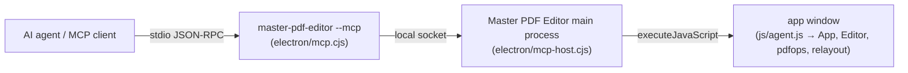

# Controlling Master PDF Editor from AI agents (MCP)

Master PDF Editor has a built-in [Model Context Protocol](https://modelcontextprotocol.io) server, so agents such as Claude Code can open, inspect and edit PDFs **in the running app**. Every change goes through the same document model and undo stack as your own edits, so you can watch it happen, select what the agent selected, and undo it with Edit > Undo.



`master-pdf-editor --mcp` speaks MCP on stdin/stdout and opens no window. When a tool is called it connects to the running app over a private per-user socket (`$XDG_RUNTIME_DIR/master-pdf-editor-mcp-<uid>.sock` on Linux, a named pipe on Windows), starting the app first if it isn't running. Listing the tools doesn't start the app.

## Setup

### Claude Code

Installed app (Linux, after `npm run install:linux`):

```bash
claude mcp add --scope user master-pdf-editor -- master-pdf-editor-mcp
```

`master-pdf-editor-mcp` runs the server with the app's binary as plain Node (`ELECTRON_RUN_AS_NODE=1`), which uses about 100 MB. `master-pdf-editor --mcp` works too, but it starts a full Electron runtime (about 570 MB) for each agent session.

From a source checkout (uses the checkout's Electron):

```bash
claude mcp add --scope user master-pdf-editor -- node /path/to/master-pdf-editor/electron/mcp.cjs
```

On Windows use `"C:\Program Files\Master PDF Editor\master-pdf-editor.exe" --mcp`; on macOS `"/Applications/Master PDF Editor.app/Contents/MacOS/Master PDF Editor" --mcp`.

### Other MCP clients

Any client that launches stdio servers works the same way, for example:

```json
{ "mcpServers": { "master-pdf-editor": { "command": "master-pdf-editor", "args": ["--mcp"] } } }
```

## How an agent should work

1. `open_pdf(path)`: the file opens in a tab (or the existing tab is activated).
2. Look first: `render_page(page)` shows the page **exactly as it will be saved** (all pending edits baked in). `overlay=true` draws element ids, `grid=true` adds rulers every 50 pt. `get_page_layout(page)` lists the elements with ids, boxes and styles; `find_text` finds text and returns its ids.
3. Edit with those ids. Original text, images and vector graphics are moved exactly inside the PDF; deleted content is really removed when saved, not covered with white. After `move_elements`, `move_region` or `flow_to_previous_page`, re-read the layout: the ids of moved original content change.
4. Check every meaningful change with `render_page`, and `undo` if it's wrong. Act on the `warnings` in tool results.
5. `save_pdf(output_path=...)`, or `save_pdf()` to overwrite (a one-time `<name>.orig.pdf` backup is made first). As in the app, saving reloads the document from the file and clears its undo history.
6. `show_page(page, select=[ids])` scrolls the window to what changed so you can see it.

While an agent call runs, the app shows no message boxes; errors and messages come back to the agent instead.

## Tools

40 tools, grouped as documents, seeing the document, deleting, text, graphics and annotations, re-layout, forms, pages and the app window. The full reference with every parameter is in [MCP_TOOLS.md](MCP_TOOLS.md).

| Group | Tools |
|---|---|
| Documents | `open_pdf`, `list_open_pdfs`, `get_document_info`, `save_pdf`, `close_pdf`, `undo`, `redo` |
| Seeing | `render_page`, `get_page_layout`, `get_text`, `find_text` |
| Deleting | `delete_elements`, `delete_region` |
| Text | `edit_text`, `replace_text`, `add_text` |
| Graphics and annotations | `add_image`, `add_shape`, `add_annotation`, `apply_redactions`, `update_element` |
| Re-layout | `move_elements`, `move_region`, `flow_to_previous_page` |
| Forms | `list_form_fields`, `fill_form`, `add_form_field`, `update_form_field`, `delete_form_field`, `flatten_form` |
| Pages | `delete_pages`, `move_pages`, `insert_blank_page`, `duplicate_page`, `rotate_pages`, `insert_pages_from_pdf`, `crop_page`, `extract_pages` |
| App window | `show_page`, `screenshot_app` |

Coordinates are PDF points with the origin at the top-left of the page as displayed (y downwards), so they match what `render_page` shows; the app converts them to PDF user space internally.

## Limits

* Edited original text is re-set in the closest standard PDF font (Helvetica, Times or Courier family), as the app's own Edit Text tool does; the tool result warns when that differs from the original font.
* Original page content can be moved to another page only while it is unedited; edit it after moving, or save first.
* File access is the desktop app's (paths must be absolute). The browser build has no MCP server.

## Developing

* Tool schemas: `electron/mcp-tools.cjs`. Implementations: `js/agent.js`. Bridge: `electron/mcp.cjs`. Socket host: `electron/mcp-host.cjs`.
* After changing tools, run `npm run docs:mcp` to regenerate `docs/MCP_TOOLS.md`.
* `npm run test:mcp` runs `scripts/mcp-e2e.mjs`: it starts the app from the checkout if needed, drives the tools over stdio like a client, checks the saved file with pdf-lib and MuPDF, and writes renders to `/tmp/mpe-mcp-*.png`.
